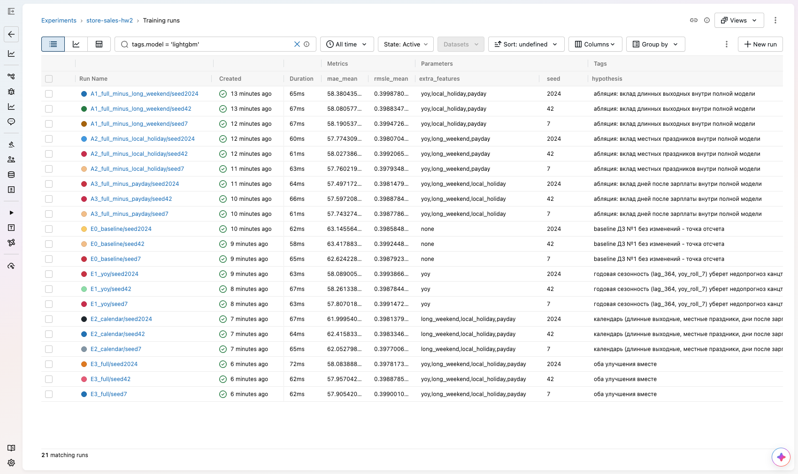
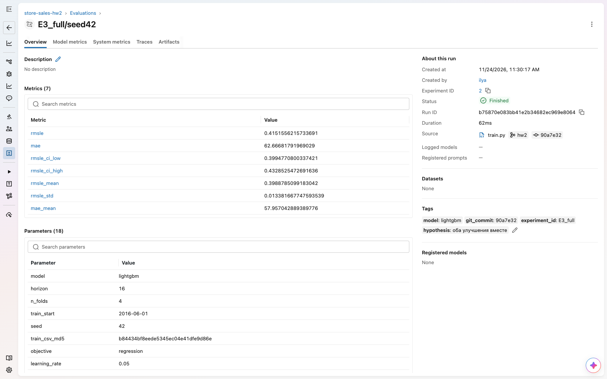
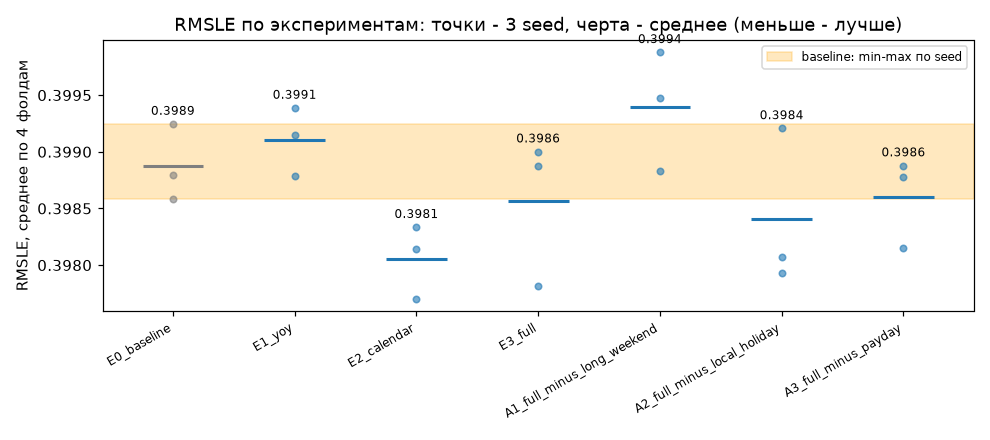
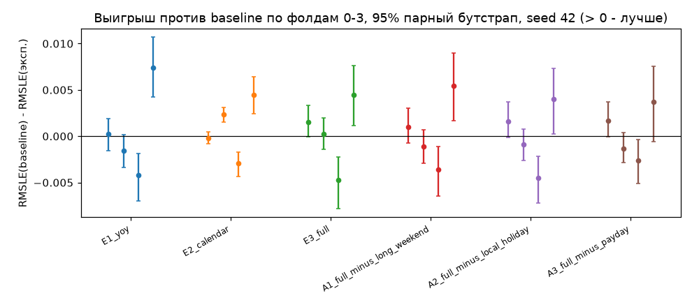
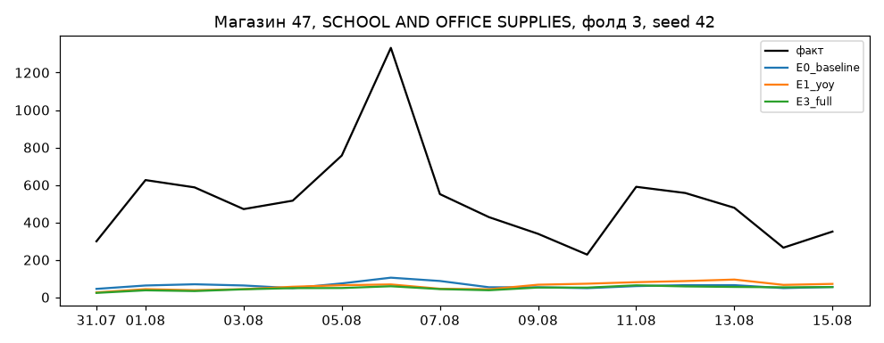
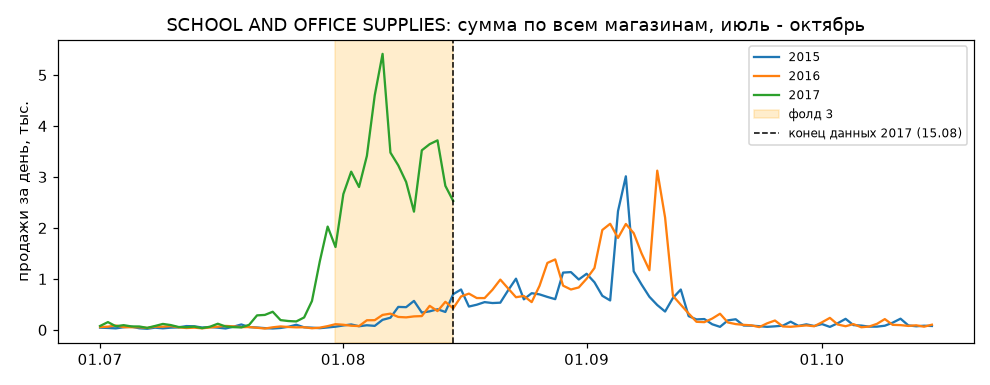
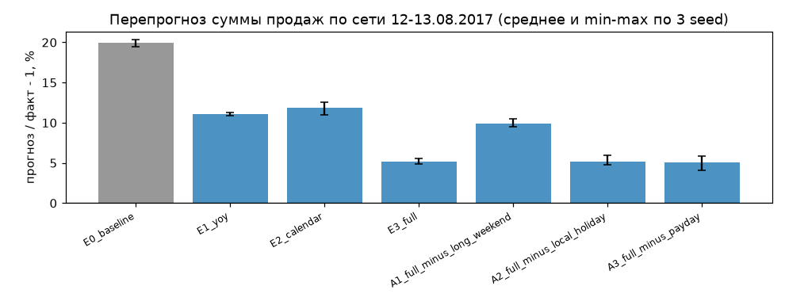

# ДЗ №2: улучшения baseline, трекинг экспериментов, абляции

Курс «R&D в ML», ИТМО. Ширяев Илья, M4150.

Задача, данные, метрика (RMSLE), 4 временных фолда и baseline - из ДЗ №1, см. [README.md](README.md). Здесь я проверяю две гипотезы из анализа ошибок ДЗ №1 и делаю абляции.

## Как запустить

```bash
uv run bash scripts/run_hw2.sh
```

Скрипт запускает `train.py` и `evaluate.py` для каждого конфига из `configs/hw2/` (7 экспериментов x 3 seed = 21 конфиг). Потом `src/compare.py` собирает таблицы и графики в `outputs/hw2/`. На моем ноутбуке весь скрипт (21 конфиг и сводка) идет 8 мин 11 с (замер 24.11.2026).

## 1. Гипотезы

Обе гипотезы взяты из анализа ошибок baseline на последнем фолде (31.07-15.08.2017), раздел «Типичные ошибки» в README.

**H1. Годовая сезонность** (группа признаков `yoy`).

- **Что увидел в ДЗ №1:** хуже всего модель прогнозирует канцтовары (SCHOOL AND OFFICE SUPPLIES) перед учебным годом. В магазине 47 продавали 228-1332 в день, а модель давала 45-105. Самый длинный лаг в baseline - 35 дней, и модель не видит, что было год назад.
- **Что добавил:** `lag_364` - `log1p(sales)` 364 дня назад (тот же день недели), `yoy_roll_7` - среднее `log1p(sales)` за 7 дней вокруг этого дня (с t-367 по t-361).
- **Что ожидаю:** снизится RMSLE канцтоваров на фолде 3 (`school_rmsle_f3`) и общий RMSLE.

**H2. Календарь** (группы `long_weekend`, `local_holiday`, `payday`).

- **Что увидел в ДЗ №1:** 12-13.08 (суббота и воскресенье после праздника, перенесенного на пятницу 11.08) модель завысила сумму продаж по сети на 19-21%. 31.07-01.08 занизила на 12-13%. Местные праздники baseline не использовал.
- **Что добавил:**
  - `dayoff_block_len` - длина блока нерабочих дней подряд (суббота, воскресенье, национальный выходной; перенесенная рабочая суббота `Work Day` выходным не считается), `long_weekend` - флаг, что блок от 3 дней;
  - `local_holiday` - праздник в городе или провинции магазина (Local и Regional из `holidays_events.csv`, без перенесенных);
  - `days_since_payday` - сколько дней прошло с зарплаты. В описании данных на Kaggle сказано, что в госсекторе зарплату платят 15-го и в последний день месяца.
- **Что ожидаю:** уменьшится смещение суммы прогноза 12-13.08 (`bias_12_13_aug_pct`) и 31.07-01.08 (`bias_31jul_1aug_pct`), снизится общий RMSLE.

Все признаки считаются в `src/utils.py`. Группы включаются списком `extra_features` в конфиге.

## 2. Эксперименты и трекинг

| эксперимент | что включено | зачем |
|---|---|---|
| E0_baseline | ничего нового | baseline ДЗ №1, точка отсчета |
| E1_yoy | yoy | проверка H1 |
| E2_calendar | long_weekend, local_holiday, payday | проверка H2 |
| E3_full | все 4 группы | оба улучшения вместе |
| A1_full_minus_long_weekend | E3 без long_weekend | абляция |
| A2_full_minus_local_holiday | E3 без local_holiday | абляция |
| A3_full_minus_payday | E3 без payday | абляция |

- **Конфиги.** Файл `configs/hw2/<эксперимент>__seed<N>.yaml` наследует `configs/baseline.yaml` через ключ `base`. В нем меняются только `experiment_id`, `hypothesis`, `extra_features`, `seed` и `output_dir`. Фолды, лаги, параметры LightGBM и 300 деревьев у всех одинаковые.
- **MLflow.** Эксперимент `store-sales-hw2`, имя запуска вида `E3_full/seed42`. Наивные модели пишутся рядом как `E3_full/seed42/seasonal_naive_7` и `.../moving_average_28`, всего 63 запуска.
  - теги: `experiment_id`, `hypothesis`, `git_commit`;
  - параметры: все `lgbm_params`, `seed`, `extra_features`, лаги, md5 файла `train.csv`;
  - метрики: `rmsle`, `mae` и границы бутстрап-интервала по фолдам, `rmsle_mean`, `rmsle_std`, `mae_mean`;
  - артефакты: конфиг, `results_by_fold.csv`, `feature_importance.csv`, `series_errors.csv` (ошибка по каждому ряду и фолду).

  Открыть: `uv run mlflow ui --backend-store-uri sqlite:///mlflow.db`. Запуски перезапущены после исправлений по ревью. Тег `git_commit` записывает HEAD на момент запуска, а состояние рабочего дерева не фиксирует. Запуски сделаны на исправленном коде до коммита, поэтому в теге стоит 90a7e32 - промежуточная локальная версия ДЗ №2, в историю ветки она не вошла. Код этих запусков - коммит с этим отчетом: повторное обучение E2_calendar на нем дает те же RMSLE на всех фолдах и seed (расхождение меньше 1e-16). Запуски первой версии в MLflow помечены удаленными.
  Запуски LightGBM в MLflow (фильтр `tags.model = 'lightgbm'`, колонки: метрики, признаки, seed, гипотеза):

  

  Один запуск: теги, метрики и параметры.

  
- **Таблица запусков без MLflow:** `outputs/hw2/runs.csv`, 21 строка. Для каждого запуска: эксперимент, гипотеза, признаки, seed, RMSLE по фолдам и среднее, MAE и срезы из раздела 4.

**Почему 3 seed.** В LightGBM стоит `feature_fraction: 0.8`, то есть каждое дерево берет случайные 80% признаков. Если добавить или убрать признак, этот выбор меняется, и RMSLE сдвигается даже от бесполезного признака. У одного и того же baseline с seed 7, 42 и 2024 средний RMSLE от 0.39859 до 0.39925. Разброс 0.00066 - того же порядка, что эффекты ниже. Поэтому каждый эксперимент запущен с 3 seed.

## 3. Честное сравнение

- **Одинаковые условия.** Те же 4 фолда (13.06-15.08.2017, по 16 дней), то же начало обучения 2016-06-01, та же метрика RMSLE, та же подготовка данных в `load_data`. Новые колонки считаются для всех, а в модель идут, только если группа включена в конфиге.
- **Нет утечки.** Все лаги не меньше горизонта 16 дней. `lag_364` и сдвиг 361 для `yoy_roll_7` тоже больше 16. Календарные признаки считаются по дате и файлу праздников, который известен заранее и покрывает тестовый период.
- **Нет подбора по тесту.** Тест и leaderboard Kaggle не использовались. Гиперпараметры не менял, сравниваю только наборы признаков, всего 7 вариантов. Отдельного holdout нет: выбор и оценка сделаны на одних и тех же 4 фолдах.
- **Сравнение на одном seed.** `delta = RMSLE(baseline, seed s) - RMSLE(эксперимент, seed s)`, потом среднее по 3 seed. delta > 0 - эксперимент лучше.
- **Критерий улучшения:** delta > 0 на всех 3 seed, и средняя delta больше разброса baseline по seed (0.00066). Это эвристический порог, а не статистический тест: 3 seed дают только грубую оценку шума обучения. Критерий проверяется в `compare.py` на полной точности (колонка `passes_criterion` в `outputs/hw2/experiments.csv`), числа в таблицах отчета округлены только для показа.
- **Почему не критерий ДЗ №1** (парный бутстрап по рядам на каждом фолде). Сравнил baseline с seed 42 и тот же baseline с seed 7 (`outputs/hw2/seed_noise_by_fold.csv`). Модель одна и та же, отличается только seed. Но на фолдах 1 и 2 интервал разницы целиком выше нуля: +0.0010 [0.0003; 0.0017] и +0.0009 [0.0003; 0.0016]. Бутстрап по рядам оценивает разницу двух конкретных обученных моделей и не учитывает случайность самого обучения (seed). На вопрос, лучше ли процедура обучения с новыми признаками, он не отвечает. Поэтому интервалы по фолдам ниже приведены только для иллюстрации (`outputs/hw2/deltas_by_fold.csv`).

## 4. Результаты

Среднее по 3 seed (`outputs/hw2/experiments.csv`):

| эксперимент | RMSLE | delta (min..max по seed) | лучше baseline | MAE | RMSLE канцтоваров, фолд 3 | смещение 12-13.08 | смещение 31.07-01.08 |
|---|---|---|---|---|---|---|---|
| E0_baseline | 0.3989 | - | - | 63.1 | 0.797 | +20.0% | -12.3% |
| E1_yoy | 0.3991 | -0.0002 (-0.0008..+0.0005) | 1 из 3 seed | 58.1 | 0.827 | +11.0% | -12.3% |
| E2_calendar | 0.3981 | +0.0008 (+0.0004..+0.0011) | 3 из 3 | 62.2 | 0.790 | +11.8% | -10.4% |
| E3_full | 0.3986 | +0.0003 (-0.0002..+0.0008) | 2 из 3 | 58.0 | 0.834 | +5.1% | -10.5% |

Смещение = сумма прогноза по всей сети / сумма факта - 1.



**По критерию из раздела 3:**

- E1_yoy - не улучшение: лучше baseline только на 1 seed из 3, средняя delta отрицательная.
- E2_calendar - улучшение: лучше на всех 3 seed, средняя delta 0.00082 при пороге 0.00066. Запас над порогом небольшой - 0.00016.
- E3_full - не улучшение: лучше baseline на 2 seed из 3, средняя delta 0.0003, это меньше порога.

**По фолдам** (разница с baseline на каждом seed, `outputs/hw2/runs.csv`):

- E1_yoy: фолд 2 (15.07-30.07) хуже на всех seed, на 0.0033-0.0044. Фолд 3 (31.07-15.08) лучше на всех seed, на 0.0005-0.0074.
- E2_calendar: фолд 1 (29.06-14.07) лучше на всех seed, на 0.0012-0.0023. Фолд 3 лучше на всех seed, на 0.0020-0.0044. Фолды 0 и 2 хуже на всех seed: на 0.0001-0.0003 и на 0.0011-0.0030.
- E3_full: фолд 2 хуже на всех seed, на 0.0039-0.0048. Фолды 0 и 3 лучше на всех seed: на 0.0008-0.0016 и на 0.0040-0.0051.



**H1, канцтовары.** RMSLE канцтоваров на фолде 3 не снизился: 0.797 у baseline (0.775-0.810 по seed) против 0.827 у E1_yoy (0.785-0.856). В магазине 47 на seed 42 прогноз с `yoy` 26-95 в день, на уровне baseline, а факт в 3-19 раз выше.



Вероятная причина видна в данных (`school_by_year.png`). Продажи канцтоваров по всей сети за 31.07-15.08:

| год | сумма за 31.07-15.08 | максимум за 01.07-15.10 (для 2017 - до 15.08, дальше данных нет) |
|---|---|---|
| 2015 | 4 564 | 06.09, 3 013 в день |
| 2016 | 4 214 | 10.09, 3 124 в день |
| 2017 | 51 795 | 06.08, 5 415 в день |

В 2015 и 2016 годах продажи за 31.07-15.08 были маленькие, а максимум сезона пришелся на сентябрь. В 2017 в этом окне уже сильный всплеск: сумма в 11-12 раз больше, а максимум 06.08 в 1.7-1.8 раза выше сентябрьских максимумов прошлых лет. Данные 2017 года заканчиваются 15.08, поэтому полный сезон 2017 и его пик не видны: можно сказать только, что в доступной части 2017 года всплеск начался раньше. В магазине 47 за 31.07-15.08.2016 продавали 1-27 в день, и `lag_364` показывает модели как раз эти маленькие продажи. Что неудача H1 объясняется именно этим, - гипотеза; другие причины (например, промо или новые поставщики в 2017) я не проверял.



**H2, календарь.** Завышение 12-13.08 уменьшилось с 20.0% до 11.8% у E2_calendar и до 5.1% у E3_full. Занижение 31.07-01.08 уменьшилось с 12.3% до 10.4% у E2_calendar.



**MAE.** С `yoy` MAE ниже на всех seed: baseline 62.6-63.4, E1_yoy 57.8-58.3, E3_full 57.9-58.1. При этом устойчивого улучшения RMSLE от `yoy` нет: у E1_yoy он в среднем даже на 0.0002 хуже baseline. Как написано в ДЗ №1, MAE больше зависит от крупных категорий, а RMSLE считает все ряды на равных.

## 5. Абляции

Из полной модели E3_full по очереди убираю одну группу. Рост RMSLE = RMSLE(без группы) - RMSLE(E3_full) на том же seed; > 0 - без группы хуже, группа полезна. Среднее по 3 seed (`outputs/hw2/ablations.csv`):

| что убрал | запуск | рост RMSLE (min..max) | хуже на seed | MAE | смещение 12-13.08 | смещение 31.07-01.08 |
|---|---|---|---|---|---|---|
| long_weekend | A1 | +0.0008 (-0.00004..+0.0021) | 2 из 3 | +0.2 | +4.8 п.п. | +0.1 п.п. |
| local_holiday | A2 | -0.0002 (-0.0011..+0.0003) | 2 из 3 | -0.1 | +0.0 п.п. | +0.5 п.п. |
| payday | A3 | +0.00004 (-0.0002..+0.0003) | 1 из 3 | -0.4 | -0.1 п.п. | -1.1 п.п. |
| yoy | E2 | -0.0005 (-0.0013..+0.0003) | 1 из 3 | +4.2 | +6.7 п.п. | +0.1 п.п. |
| весь календарь | E1 | +0.0005 (-0.0001..+0.0016) | 2 из 3 | +0.1 | +5.9 п.п. | -1.8 п.п. |

Сама полная модель E3_full по seed разбросана на 0.0012 - почти вдвое больше порога из раздела 3, поэтому абляции от нее шумные.

**Сводка фактов:**

- **long_weekend.** Без него RMSLE в среднем хуже на 0.0008, но только на 2 seed из 3: на seed 42 разница -0.00004. Завышение 12-13.08 растет с 5.1% до 9.9%. На seed 42 в фолде 3 RMSLE за 11-13.08 без признака 0.4152, с признаком 0.4102, в остальные дни фолда 0.4140 и 0.4163. Длинные выходные во всех 4 фолдах только 11-13.08, но без признака RMSLE меняется и на других фолдах: фолд 1 хуже на всех seed, на 0.0008-0.0014. Значит, часть эффекта идет не от самих длинных выходных, а от того, что модель обучается по-другому.
- **local_holiday.** Без него RMSLE в среднем даже лучше на 0.0002 (от -0.0011 до +0.0003). Полезного эффекта не видно. В 4 фолдах местный праздник есть только в 29 магазино-днях из 3456 (0.8%). В E3_full на seed 42 это 22-й признак из 23 по gain: 206 из 46 млн суммарного gain.
- **payday.** Средний рост +0.00004, от -0.0002 до +0.0003, хуже только на 1 seed из 3 - на уровне шума. Занижение 31.07-01.08 без признака 11.6% вместо 10.5%.
- **yoy внутри полной модели.** Без него RMSLE в среднем лучше на 0.0005 (E2_calendar против E3_full, лучше на 2 seed из 3), но MAE выше на 4.2, а завышение 12-13.08 растет с 5.1% до 11.8%.
- **Весь календарь.** Без него RMSLE в среднем хуже на 0.0005 (от -0.0001 до +0.0016), на 2 seed из 3.

## 6. Ограничения

- Все 4 фолда - лето 2017 года. Длинные выходные в них только одни (11-13.08), местные праздники - 0.8% магазино-дней.
- 3 seed - мало, чтобы точно оценить шум. Средние эффекты всех экспериментов по модулю не больше 0.0008, а разброс по seed доходит до 0.0012 (E3_full), то есть того же порядка.
- Нет отдельного holdout. Если выбирать лучший набор признаков по этой же таблице, оценка будет немного оптимистичной.
- Абляции сделаны только от E3_full. Вклад отдельных групп календаря в выигрыш E2_calendar отдельно не измерялся.

## 7. Выводы

- **Календарь дал лучший результат.** E2 - единственный эксперимент, прошедший критерий улучшения: RMSLE снизился в среднем на 0.0008, с улучшением на всех трех seed, но запас над порогом небольшой. Завышение продаж 12-13 августа уменьшилось с 20.0% до 11.8%, а в полной модели - до 5.1%. Абляция в полной модели указывает на возможную пользу `long_weekend`, прежде всего для завышения 12-13 августа: без него завышение растет с 5.1% до 9.9%, а RMSLE хуже на 2 seed из 3. Его вклад в выигрыш самой E2 отдельно не проверялся: для этого нужна абляция E2.
- **Годовая сезонность не решила проблему канцтоваров.** RMSLE категории на последнем фолде вырос с 0.797 до 0.827. Вероятная причина: в 2015-2016 годах продажи канцтоваров росли к сентябрю, а в доступных данных 2017 года всплеск начался уже в начале августа, поэтому `lag_364` показывал модели низкие прошлогодние продажи. Это гипотеза: данные 2017 года заканчиваются 15.08. При этом MAE снизился с 63.1 до 58.1, то есть признаки оказались полезны для абсолютной ошибки, но не для целевой метрики.
- **Полная модель не превзошла календарь.** E3 улучшила RMSLE только на 0.0003 и только на 2 seed из 3 - ниже порога 0.00066, хотя среди E0-E3 показала наименьшие MAE и смещение прогноза на длинных выходных.
- **Устойчивой пользы `payday` и местных праздников не видно.** Для `payday` среднее изменение RMSLE +0.00004 при разбросе от -0.0002 до +0.0003, на уровне шума между seed. Без местных праздников RMSLE в среднем даже на 0.0002 лучше; они встречаются лишь в 0.8% магазино-дней.
- **Главное ограничение - малая устойчивость эффектов.** Все средние изменения RMSLE не больше 0.0008 по модулю, это тот же порядок, что разброс между seed: 0.00066 у baseline и 0.0012 у полной модели. Кроме того, все фолды относятся к лету 2017 года и содержат только одни длинные выходные, поэтому переносить выводы на другие периоды пока нельзя.