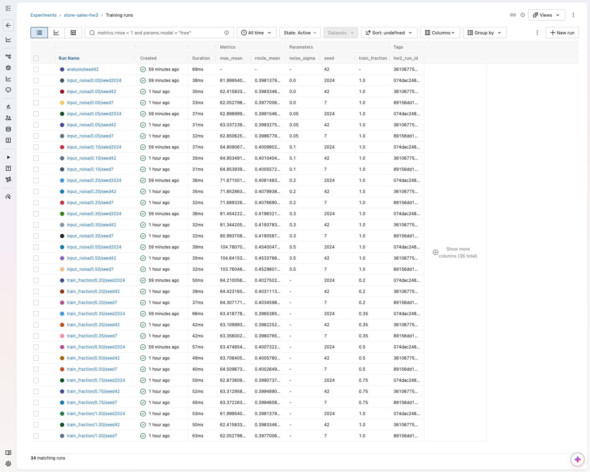
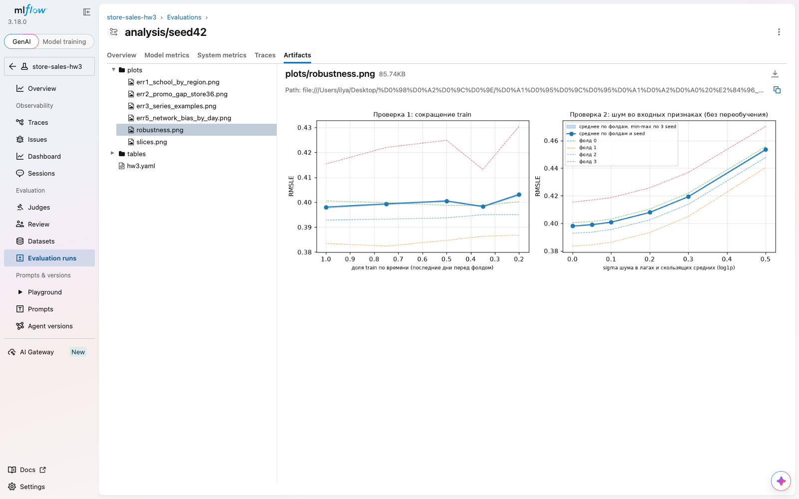
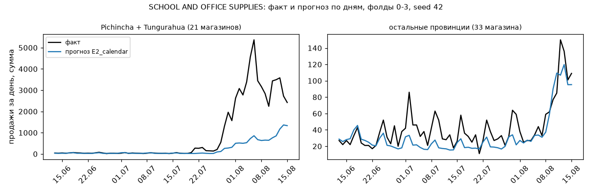
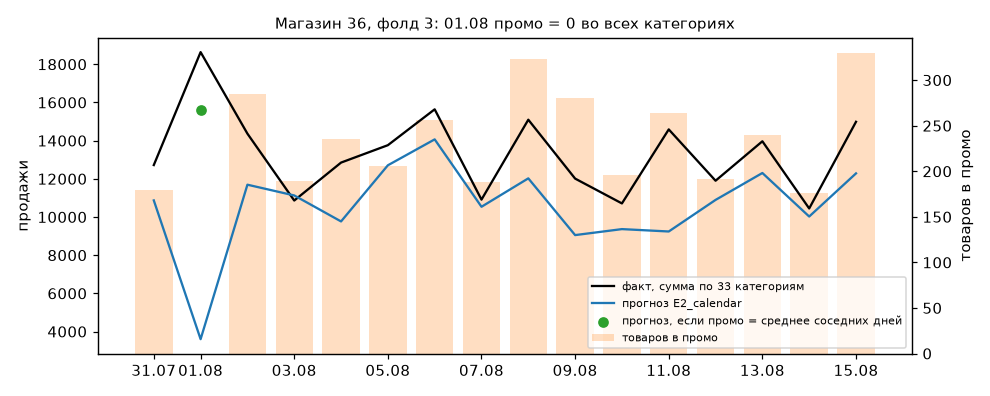
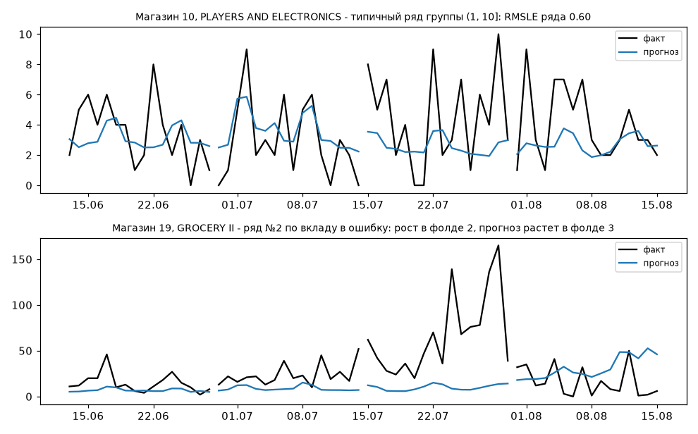
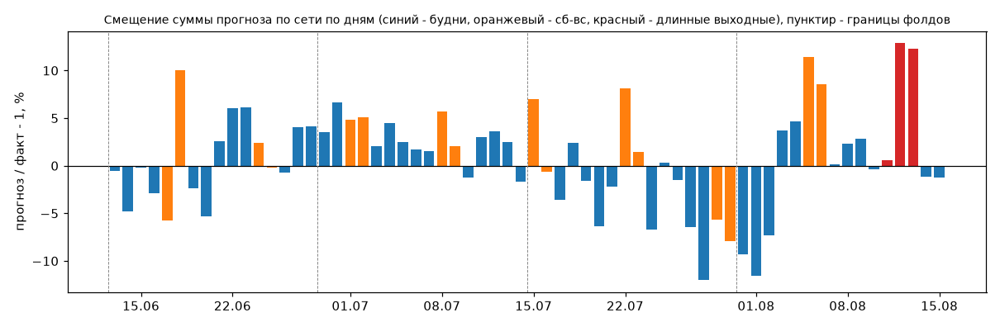
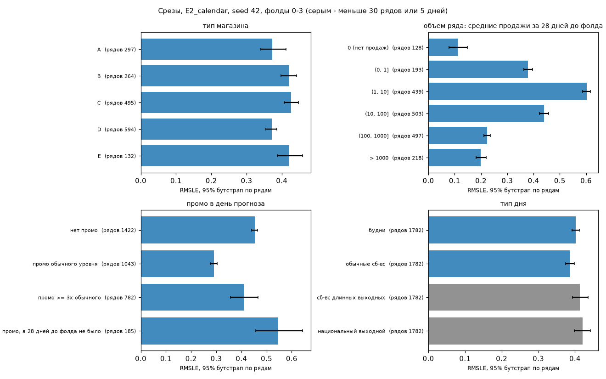
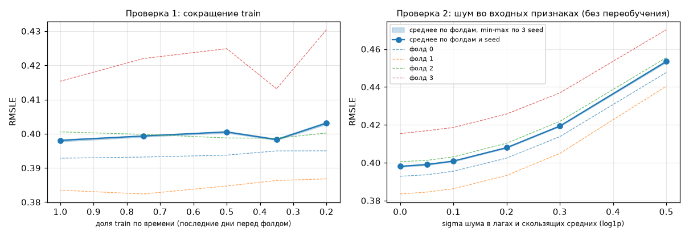

# ДЗ №3: анализ ошибок, срезы, устойчивость и ограничения

Курс «R&D в ML», ИТМО. Ширяев Илья, M4150.

Задача, данные, метрика (RMSLE) и 4 временных фолда - из ДЗ №1, см. [README.md](README.md). Выбранное решение - из ДЗ №2, см. [HW2.md](HW2.md). Здесь я разбираю, где и почему оно ошибается, насколько оно устойчиво и где его нельзя применять. Новых улучшений и абляций нет.

## Как запустить

```bash
uv run bash scripts/run_hw3.sh
```

Скрипт делает два шага:

- `src/hw3_experiments.py` - заново обучает E2_calendar на 4 фолдах с 3 seed и делает обе проверки устойчивости. Прогнозы всех 4 фолдов сохраняются в `outputs/hw3/predictions/`, модели seed 42 - в `outputs/hw3/models/`. Обе папки (около 18 МБ) в git не входят, их пересоздает скрипт.
- `src/hw3_analysis.py` - анализ ошибок, срезы, сводка проверок. Таблицы - `outputs/hw3/*.csv`, графики - `outputs/hw3/plots/`. Здесь ничего не обучается.

Все настройки - в `configs/hw3/hw3.yaml`. Код ДЗ №1-2 не менялся, новые скрипты только импортируют его. На моем ноутбуке полный прогон занял 2 мин 30 с, из них обучение 132 с.

Быстрая проверка (1 seed, 1 фолд, 2 доли train, без MLflow), около 15 с. Она пишет в отдельный каталог `outputs/hw3_smoke` (в git не входит) и полные результаты в `outputs/hw3` не трогает:

```bash
uv run python src/hw3_experiments.py --seeds 42 --fractions 1.0 0.2 --sigmas 0 0.1 --folds 3 --output-dir outputs/hw3_smoke --no-mlflow
```

Повторный анализ без переобучения: `uv run python src/hw3_analysis.py`, около 13 с. Прежний запуск `analysis/seed42` в MLflow при этом помечается удаленным. Перед анализом скрипт проверяет полноту входов: 3 seed и 4 фолда, 114 048 строк прогноза на seed, уникальные ключи (фолд, дата, магазин, категория), все доли train и sigma, модели seed 42. Если чего-то нет, он останавливается и пишет, чего не хватает.

**MLflow.** Эксперимент `store-sales-hw3`, 34 запуска: 15 с сокращенным train (`train_fraction/<доля>/seed<N>`), 18 с шумом (`input_noise/<sigma>/seed<N>`) и 1 запуск анализа (`analysis/seed42`, в нем все таблицы и графики). В тегах `hw2_run_id` - запуск ДЗ №2 с тем же seed. База отдельная, `outputs/hw3/mlflow.db`, чтобы не трогать `mlflow.db` из ДЗ №1-2. Скрипт пересоздает ее при каждом запуске, поэтому запуски не дублируются. Открыть:

```bash
uv run mlflow ui --backend-store-uri sqlite:///outputs/hw3/mlflow.db
```

База и артефакты MLflow в git не входят (`.gitignore`), поэтому ниже скриншоты.



Таблица всех 34 запусков: метрики `rmsle_mean` и `mae_mean`, параметры `noise_sigma`, `seed`, `train_fraction`, тег `hw2_run_id`.



Запуск анализа: графики и таблицы ДЗ №3 сохранены как артефакты, открыт график проверок устойчивости.

## Выбранное решение

- **Решение:** E2_calendar - baseline ДЗ №1 + группы признаков `long_weekend`, `local_holiday`, `payday` (HW2.md, раздел 1, гипотеза H2).
- **Конфигурация:** `configs/hw2/E2_calendar__seed42.yaml` (и seed 7, 2024). `configs/hw3/hw3.yaml` наследует его через `base` и меняет только папку результатов, базу MLflow и настройки анализа. Признаки, лаги, LightGBM, 300 деревьев и фолды те же.
- **Метрика в ДЗ №2:** RMSLE, среднее по 4 фолдам и 3 seed - 0.39806 (0.3977-0.3983 по seed). Лучше baseline на 0.0008 (от 0.0004 до 0.0011), на всех 3 seed (HW2.md, раздел 4, `outputs/hw2/experiments.csv`).
- **Эксперимент ДЗ №2:** MLflow `store-sales-hw2` в `mlflow.db`, запуск `E2_calendar/seed42` (run_id `3610677582f7420590fa41d49a44f0c8`), seed 7 - `89156dd17d0a40d0946bf333b8e80be9`, seed 2024 - `074dac2481474cbebc846846b71be386`.
- **Почему оно:** по критерию из раздела 3 HW2.md это единственное улучшение: лучше baseline на всех 3 seed, и средняя delta 0.00082 больше разброса baseline по seed (0.00066, `passes_criterion` в `outputs/hw2/experiments.csv`). Порог эвристический, запас над ним небольшой - 0.00016.
- **Повторяемость:** при полном train модель совпадает с ДЗ №2. RMSLE по всем 4 фолдам и 3 seed совпадает с `outputs/hw2/E2_calendar/seed<N>/results_by_fold.csv` на полной точности, разница не больше 6e-17 (`outputs/hw3/check_vs_hw2.csv`).
- **На чем анализ:** разделы 1 и 2 - seed 42, все 4 фолда: 1782 ряда x 64 дня = 114 048 строк. В ДЗ №1-2 ошибки смотрел только на последнем фолде. В срезах дополнительно показан min-max RMSLE по 3 seed.

Выбор решения можно поменять: в `configs/hw3/hw3.yaml` заменить `base`, `experiment_id` и `hw2_runs` на другой эксперимент ДЗ №2 и перезапустить скрипт.

## 1. Анализ ошибок

С чего начал: 30 худших строк и 30 рядов с наибольшим вкладом в общую ошибку (`outputs/hw3/errors_top_rows.csv`, `errors_top_series.csv`). Потом для каждой группы похожих ошибок проверял гипотезу отдельной таблицей. Ниже 5 типовых ошибок. Для каждой отделяю наблюдение (видно в данных) от гипотезы (мое объяснение) и пишу, как гипотезу проверял.

Смещение в логах = среднее `log1p(прогноз) - log1p(факт)`: > 0 - перепрогноз, < 0 - недопрогноз.

### Ошибка 1. Начало школьного сезона в двух провинциях

**Пример.** Три худшие строки из 114 048 - канцтовары (SCHOOL AND OFFICE SUPPLIES) в магазине 45 (Кито, Pichincha) 21-23.07: факт 241, 241, 267, прогноз 2.0, 3.0, 4.4. Это фолд 2, а не последний фолд, который я смотрел в ДЗ №1-2.

**Наблюдение.** Канцтовары, сумма за фолд (`outputs/hw3/errors_1_school_by_state.csv`):

| провинция | факт, фолды 0 / 1 / 2 / 3 | прогноз, фолды 0 / 1 / 2 / 3 | факт год назад, фолд 3 |
|---|---|---|---|
| Pichincha | 667 / 521 / 5 521 / 44 487 | 516 / 513 / 1 051 / 11 152 | 3 848 |
| Tungurahua | 38 / 25 / 37 / 6 242 | 59 / 48 / 55 / 869 | 264 |
| Guayas | 222 / 320 / 284 / 261 | 233 / 164 / 177 / 180 | 278 |

- Основной по абсолютному объему всплеск сосредоточен в двух провинциях (небольшой рост на фолде 3 есть и в других, например Cotopaxi: 0 -> 153). В Pichincha и Tungurahua 21 магазин из 54. На них приходится 69% квадратичной ошибки канцтоваров на фолде 2 и 75% на фолде 3 (`errors_summary.csv`).
- В Pichincha рост начался около 20.07 (фолд 2). На фолде 3 факт в 4.0 раза больше прогноза, в Tungurahua - в 7.2 раза.
- Вне этих двух провинций суммарный прогноз по дням идет за суммарным фактом (график ниже, справа). Это сходство только агрегированной динамики: RMSLE канцтоваров вне двух провинций 0.452 на всех фолдах и 0.511 на фолде 3, в двух провинциях - 0.752 и 1.099 (`errors_summary.csv`). В отдельных провинциях есть заметные промахи, например Guayas на фолде 1: факт 320, прогноз 164.



**Гипотеза.** У регионов разный школьный сезон. В Pichincha и Tungurahua покупки к учебному году приходятся на август-сентябрь, в остальных провинциях - на весну. Модель видит продажи не позже чем за 16 дней и не видит прошлый год, поэтому начало сезона пропускает.

**Проверка.** Продажи канцтоваров по месяцам за всю историю (`errors_1_school_by_month.csv`):

| месяц | Pichincha+Tungurahua | остальные |
|---|---|---|
| 2015-08 / 2015-09 | 15 037 / 14 259 | 1 111 / 1 460 |
| 2016-04 / 2016-05 | 3 041 / 2 629 | 5 909 / 7 798 |
| 2016-08 / 2016-09 | 15 679 / 21 970 | 1 535 / 1 586 |
| 2017-04 / 2017-05 | 3 422 / 2 334 | 25 267 / 7 324 |
| 2017-08 (до 15.08) | 49 162 | 1 007 |

Подтверждено данными: у двух регионов разная сезонность продаж канцтоваров. Пик августа-сентября в Pichincha+Tungurahua повторяется в 2015-2017, весенний пик в остальных провинциях - в 2016-2017 (в январе-мае 2015 продаж канцтоваров в данных нет, а годы до 2015 в таблицу не входят). Связь с учебным годом остается гипотезой: даты учебного года в Эквадоре я по первичному источнику не проверял. В 2017 году сезон в Pichincha+Tungurahua начался раньше и был больше: за 1-15.08.2017 продали больше, чем за весь сентябрь 2016. Это возможное объяснение, почему `lag_364` в ДЗ №2 не помог (HW2.md, раздел 4); причинно оно не проверено.

### Ошибка 2. Аномальные нули промо (кандидаты на пропуск в данных)

**Пример.** Магазин 36 (Libertad), 01.08: `onpromotion = 0` во всех 33 категориях. Накануне в промо 179 товаров, на следующий день - 285. Продажи при этом обычные. Сумма факта 18 635, прогноза 3 601: прогноз на 81% ниже факта. BEVERAGES: факт 4 359, прогноз 173. GROCERY I: 6 014 и 329. PRODUCE: 3 316 и 190 (`errors_top_rows.csv`).



**Наблюдение.** Ищу магазино-дни, где промо 0 во всех категориях, а накануне или на следующий день больше 100. Закрытые дни не считаю: 25.12.2016, который добавляет `load_data` (его нет в `train.csv`, `use_for_train = False`), и дни, когда у магазина нет продаж совсем (1 января и другие закрытия). С 2016-06-01 правило срабатывает на 214 магазино-днях: 53 из них - добавленное 25.12.2016, еще 57 - дни без продаж. Остается 104 кандидата на аномалию промо: 98 до первого фолда (то есть в train всех фолдов) и 6 в validation (`errors_summary.csv`). Это кандидаты, а не доказанные пропуски: настоящее промо в эти дни неизвестно.

**Гипотеза.** Ноль промо в такие дни - пропуск в данных, а не настоящий день без акций. Тогда модель верит, что промо нет, и сильно занижает прогноз крупных категорий, а кандидаты в train дают ей неверную метку промо. Это не доказано: другого источника о промо в данных нет.

**Проверка (контрфактическая проверка чувствительности).** Беру ту же модель (сохраненную; на проверенных аномальных магазино-днях ее прогноз совпадает с прогнозом в `predictions/` с точностью около 2e-13) и подставляю промо = среднее соседних дней. Это показывает, насколько прогноз зависит от `onpromotion`, но не доказывает, что ноль был пропуском. Промо на дни прогноза известно заранее (оно есть в `test.csv`), так что такую подстановку можно сделать и в реальном прогнозе. `outputs/hw3/errors_2_promo_gaps.csv`:

| фолд | дата | магазин | промо накануне / после | факт | прогноз | прогноз, промо заполнено | RMSLE | RMSLE, промо заполнено |
|---|---|---|---|---|---|---|---|---|
| 2 | 27.07 | 16 | 1381 / 157 | 5 571 | 3 961 | 5 288 | 0.356 | 0.456 |
| 2 | 28.07 | 41 | 132 / 149 | 12 064 | 9 400 | 10 863 | 0.401 | 0.374 |
| 2 | 28.07 | 53 | 119 / 147 | 11 184 | 8 816 | 10 378 | 0.438 | 0.444 |
| 3 | 01.08 | 3 | 181 / 405 | 34 630 | 16 045 | 36 382 | 0.563 | 0.290 |
| 3 | 07.08 | 8 | 145 / 131 | 18 422 | 19 283 | 20 263 | 0.374 | 0.373 |
| 3 | 01.08 | 36 | 179 / 285 | 18 635 | 3 601 | 15 588 | 1.050 | 0.473 |

- В двух самых больших случаях (магазины 3 и 36, 01.08) подстановка сильно меняет прогноз и приближает его к факту. Магазин 36: ошибка относительно факта - прогноз на 81% ниже (3 601 против 18 635); изменение прогноза при подстановке - с 3 601 до 15 588, в 4.3 раза; RMSLE магазино-дня с 1.050 до 0.473. Магазин 3: прогноз на 54% ниже факта (16 045 против 34 630), при подстановке 36 382, RMSLE с 0.563 до 0.290. Это подтверждает сильную чувствительность прогноза к промо, но не сам пропуск.
- В остальных 4 случаях RMSLE почти не меняется или растет. В магазине 16 накануне было 1381 товар в промо, это необычно много, и среднее соседних дней - плохая замена.
- Смещение суммы по сети 01.08 - минус 11.6%, после заполнения промо - минус 8.3% (`errors_5_network_bias_by_day.csv`). За 31.07-01.08 - минус 10.5% и минус 8.8%. То есть часть недопрогноза «после зарплаты» из ДЗ №1-2 может объясняться нулем промо в двух магазинах, если этот ноль действительно пропуск.

### Ошибка 3. Маленькие шумные ряды

**Пример.** Магазин 10, PLAYERS AND ELECTRONICS: факт скачет от 0 до 10 в день, прогноз 1.9-5.9. RMSLE ряда 0.60 - как у всей группы маленьких рядов (выбран автоматически, `errors_3_typical_series.csv`).



**Наблюдение.** Делю ряды по средним продажам за 28 дней до начала фолда. Ряды с продажами 1-10 в день - 22% строк (24 816 из 114 048), но на них 50% всей квадратичной ошибки, RMSLE 0.602. У рядов с продажами больше 1000 в день RMSLE 0.199 (раздел 2, срез «объем ряда»).

**Гипотеза.** На маленьких рядах ошибка - в основном случайные колебания день ко дню, а не неверный уровень. Число покупок 2 или 8 в день мало предсказуемо. RMSLE считает это как разницу в разы.

**Проверка.** Для каждого ряда на фолде раскладываю MSE в логах на квадрат смещения и разброс. И считаю «оракула»: лучший постоянный прогноз ряда на фолде (среднее `log1p(факт)` за фолд). Он знает факт, поэтому это не модель, а лучший постоянный уровень ряда на фолде. Для прогноза, который меняется по дням, это не нижняя граница. `outputs/hw3/errors_3_low_volume.csv`:

| объем ряда | рядо-фолдов | RMSLE модели | RMSLE оракула | доля смещения в ошибке | доля дней с нулем |
|---|---|---|---|---|---|
| 0 (нет продаж) | 435 | 0.111 | 0.137 | 25% | 99% |
| (0, 1] | 574 | 0.379 | 0.371 | 14% | 73% |
| (1, 10] | 1551 | 0.602 | 0.577 | 19% | 12% |
| (10, 100] | 1830 | 0.440 | 0.463 | 21% | 0% |
| (100, 1000] | 1887 | 0.223 | 0.298 | 24% | 0% |
| > 1000 | 851 | 0.199 | 0.262 | 26% | 0% |

- Для рядов 1-10 в день 81% MSE в логах - дисперсия остатков внутри фолда, 19% - постоянное смещение. Идеально угаданный постоянный уровень дал бы RMSLE 0.577 против 0.602 у модели.
- На рядах от 10 в день модель лучше оракула (например, 0.223 против 0.298 для 100-1000): меняющийся по дням прогноз выигрывает у постоянного уровня. Какие признаки дают выигрыш (вероятно, день недели и промо), это сравнение не показывает. В группах (0, 1] и (1, 10] она хуже оракула (0.379 против 0.371 и 0.602 против 0.577), то есть колебания внутри фолда почти не объясняет. В группе без продаж модель лучше оракула (0.111 против 0.137).
- Подтверждено только одно: у маленьких рядов в ошибке преобладает изменчивость остатков, а не постоянное смещение. Это не значит, что остатки - неустранимый шум: в них может быть пропущенная недельная сезонность, реакция на промо и другие закономерности. Отделить объяснимую часть от случайности спроса эта проверка не может.

### Ошибка 4. Резкие всплески

**Определение.** Всплеск - факт не меньше 5 уровней ряда и не меньше 20. Уровень - `expm1(roll_mean_28)`, то есть то, что модель видит на входе.

**Примеры** (`errors_4_spikes_top.csv`):

- магазин 30, CLEANING, 10.07: факт 10 392, прогноз 484, в промо 23 товара;
- магазин 32, CLEANING, 06.07: факт 7 435, прогноз 369;
- магазин 16, LIQUOR,WINE,BEER, 20.06: факт 712, прогноз 24;
- магазин 21, HOME AND KITCHEN II, 28.06: факт 549, прогноз 26;
- магазин 19, GROCERY II (второй ряд по вкладу в ошибку): в фолде 2 продажи выросли с 10-50 до 70-165 в день. Модель видит это только через 16 дней и в последние дни фолда 3 дает 42-53 при факте 1-6 (кроме 12.08, там 50; график выше, снизу).

**Наблюдение** (`errors_4_spikes_summary.csv`):

- всплесков 441 строка (0.39%), а на них 7.0% всей квадратичной ошибки. RMSLE на всплесках 1.69, на остальных строках 0.385;
- 191 из 441 - канцтовары, это ошибка 1. Дальше по числу: LIQUOR,WINE,BEER 67, GROCERY II 54, HOME AND KITCHEN I 26 (`errors_4_spikes_by_family.csv`);
- медиана факт / прогноз на всплесках - 5.1;
- 83% всплесков в дни с промо, у остальных строк - 43%.

**Гипотеза.** Часть всплесков - крупные разовые покупки, часть - промо намного больше обычного. Модель знает только число товаров в промо, а не насколько оно необычно для этого ряда.

**Проверка.** Частота всплесков в train последнего фолда (2016-06-01 - 2017-07-30, 744 942 строки, `errors_4_spike_rate_train.csv`): 0.72% строк. С промо - 1.19%, без промо - 0.35%. Наблюдаемая частота всплесков при промо в 3.4 раза выше, чем без промо (это сравнение разных групп без учета категории, объема и магазина, а не эффект промо), но даже с промо всплеск бывает примерно в 1 случае из 100. Для модели это редкое событие, и она часто его существенно недооценивает: на 172 из 441 всплеска прогноз тоже выше порога всплеска, но медианное отношение факта к прогнозу 5.1. В срезе по промо (раздел 2) у строк, где промо в 3 раза больше обычного, смещение минус 0.059: модель недооценивает необычное промо. Гипотезу про разовые крупные покупки не проверял: в данных нет чеков по покупателям.

### Ошибка 5. Смещение суммы по сети в отдельные дни

**Наблюдение.** Смещение суммы прогноза по всей сети по дням 4 фолдов (`errors_5_network_bias_by_day.csv`). Больше 10% по модулю - 6 дней из 64:

| дата | фолд | смещение |
|---|---|---|
| 18.06 (вс) | 0 | +10.0% |
| 28.07 (пт) | 2 | -12.0% |
| 01.08 (вт) | 3 | -11.6% |
| 05.08 (сб) | 3 | +11.4% |
| 12.08 (сб) | 3 | +12.9% |
| 13.08 (вс) | 3 | +12.3% |



- **12-13.08, длинные выходные.** E2_calendar уменьшил перепрогноз с 20.0% до 11.8% (среднее по seed, ДЗ №2), на seed 42 он +12.5% (сумма прогноза за 12-13.08 / сумма факта - 1, как в ДЗ №2; `errors_summary.csv`). В срезе по типу дня (раздел 2) у выходных длинных выходных самое большое смещение, +0.069. 05.08 - обычная суббота сразу после недопрогноза конца июля, там тоже +11.4%.
- **27.07-02.08, серия недопрогноза.** По сети минус 8.6%. Вне Pichincha и Tungurahua минус 12.2%, в них минус 5.4%. Больше всего в CLEANING (минус 25.1%), GROCERY I (минус 9.5%), BEVERAGES (минус 10.4%) (`errors_5_late_july_window.csv`).
- CLEANING по дням (`errors_5_cleaning_by_day.csv`): 27.07-01.08 недопрогноз от 22% до 31% в день. Число товаров в промо при этом 916-1054, как в середине июля (958-1104 за 15-19.07). Сразу после, 04-06.08, перепрогноз 18.5-19.6%.

**Гипотеза.** В конце июля было сетевое событие, которого нет в признаках (акция без отражения в `onpromotion` или покупки после зарплаты в конце месяца). Люди купили бытовую химию заранее, и в начале августа покупали меньше. Не проверено: данных об акциях сети нет. Признак `days_since_payday` в модели есть, но в конце июня такого недопрогноза нет. Часть недопрогноза 01.08 может объясняться нулем промо (ошибка 2): минус 11.6% и минус 8.3% после подстановки. Для 28.07 заполнение промо почти ничего не меняет: минус 12.0% и минус 11.6%.

### Сводка фактов

- Ошибки 1, 2 и 4 - это ошибки на событиях, которых модель не видит: начало сезона, вероятный пропуск в данных о промо, разовый всплеск. Ошибка 3 - высокая изменчивость остатков на маленьких рядах. Ошибка 5 видна только на сумме по сети.
- Подтверждено данными: региональная сезонность продаж канцтоваров (август-сентябрь в Pichincha+Tungurahua в 2015-2017, весна в остальных провинциях в 2016-2017; связь с учебным годом - гипотеза), сильная чувствительность прогноза к нулю промо в магазинах 3 и 36 (01.08), преобладание изменчивости остатков над постоянным смещением на маленьких рядах, рост частоты всплесков в 3.4 раза при промо.
- Не подтверждено: что нули промо - пропуски в данных, причина недопрогноза 27.07-02.08, разовые крупные покупки как причина всплесков.
- Кандидаты на аномалию промо есть и в train: 98 магазино-дней с 2016-06-01 до первого фолда. Если это пропуски, это проблема данных, а не модели.

**Вывод.** Анализ выделил две основные группы ошибок: события, которые модель не учитывает, - региональное начало школьного сезона, вероятные пропуски промо (аномальные нули) и редкие всплески - и высокую вариативность маленьких рядов. Для рядов с продажами 1-10 в день 80.7% MSE в логах приходится на дисперсию ошибки после учета среднего смещения. Причина недопрогноза 27.07-02.08 осталась неустановленной; заполнение промо существенно улучшило только два самых крупных случая из шести, поэтому такая коррекция не универсальна.

## 2. Диагностика по срезам

**Почему эти срезы.** Тип магазина - формат и размер. Объем ряда - главный фактор из ошибки 3. Промо - главный признак события и связан с ошибками 2 и 4. Тип дня - календарь, ради которого делалось E2_calendar.

**Как считал.** Seed 42, 4 фолда. RMSLE по всем строкам группы. 95% интервал - бутстрап по рядам (1000 раз выбираю ряды группы с повторами, RMSLE по всем их строкам). Смещение - среднее `log1p(прогноз) - log1p(факт)`. Доля ошибки - доля группы в общей сумме квадратов ошибок. RMSLE по seed - min-max на seed 7, 42, 2024. Малая группа - меньше 30 рядов или меньше 5 дней. Объем ряда и обычное промо считаются за 28 дней до начала фолда, то есть известны в момент прогноза.



**Тип магазина** (`outputs/hw3/slices_type.csv`):

| тип | строк | рядов | RMSLE [95%] | RMSLE по seed | смещение | доля ошибки |
|---|---|---|---|---|---|---|
| A | 19 008 | 297 | 0.373 [0.340; 0.412] | 0.369-0.373 | +0.005 | 14.6% |
| B | 16 896 | 264 | 0.420 [0.398; 0.442] | 0.420-0.421 | +0.004 | 16.5% |
| C | 31 680 | 495 | 0.426 [0.406; 0.447] | 0.425-0.426 | +0.001 | 31.8% |
| D | 38 016 | 594 | 0.371 [0.354; 0.386] | 0.371-0.372 | +0.004 | 28.9% |
| E | 8 448 | 132 | 0.422 [0.387; 0.459] | 0.422-0.422 | -0.009 | 8.3% |

**Объем ряда** - средние продажи за 28 дней до фолда (`slices_volume.csv`):

| объем | строк | рядов | RMSLE [95%] | RMSLE по seed | смещение | доля ошибки |
|---|---|---|---|---|---|---|
| 0 (нет продаж) | 6 960 | 128 | 0.111 [0.079; 0.149] | 0.110-0.111 | +0.022 | 0.5% |
| (0, 1] | 9 184 | 193 | 0.379 [0.364; 0.396] | 0.379-0.380 | +0.015 | 7.3% |
| (1, 10] | 24 816 | 439 | 0.602 [0.587; 0.616] | 0.600-0.602 | -0.012 | 49.6% |
| (10, 100] | 29 280 | 503 | 0.440 [0.423; 0.458] | 0.438-0.440 | -0.008 | 31.3% |
| (100, 1000] | 30 192 | 497 | 0.223 [0.211; 0.236] | 0.223-0.226 | +0.005 | 8.3% |
| > 1000 | 13 616 | 218 | 0.199 [0.181; 0.220] | 0.198-0.199 | +0.024 | 3.0% |

**Промо в день прогноза** (`slices_promo.csv`). «Обычное» - среднее число товаров в промо у ряда за 28 дней до фолда:

| промо | строк | рядов | RMSLE [95%] | RMSLE по seed | смещение | доля ошибки |
|---|---|---|---|---|---|---|
| нет промо | 64 393 | 1422 | 0.453 [0.441; 0.465] | 0.452-0.453 | -0.006 | 72.8% |
| промо обычного уровня | 42 499 | 1043 | 0.291 [0.277; 0.304] | 0.291-0.292 | +0.024 | 19.9% |
| промо >= 3x обычного | 6 382 | 782 | 0.411 [0.356; 0.467] | 0.403-0.411 | -0.059 | 6.0% |
| промо, а 28 дней до фолда не было | 774 | 185 | 0.546 [0.456; 0.644] | 0.536-0.546 | -0.010 | 1.3% |

**Тип дня** (`slices_day_type.csv`):

| тип дня | строк | дней | RMSLE [95%] | RMSLE по seed | смещение | доля ошибки |
|---|---|---|---|---|---|---|
| будни | 80 190 | 45 | 0.402 [0.392; 0.412] | 0.401-0.402 | -0.007 | 71.5% |
| обычные сб-вс | 28 512 | 16 | 0.386 [0.374; 0.398] | 0.385-0.386 | +0.017 | 23.4% |
| сб-вс длинных выходных (малая группа) | 3 564 | 2 | 0.413 [0.393; 0.436] | 0.412-0.413 | +0.069 | 3.4% |
| национальный выходной (малая группа) | 1 782 | 1 | 0.420 [0.398; 0.442] | 0.415-0.420 | +0.031 | 1.7% |

Еще 4 среза только в csv: категория (`slices_family.csv`), кластер магазина (`slices_cluster.csv`), местный праздник (`slices_local_holiday.csv`), фолд (`slices_fold.csv`).

### Сводка фактов

- **Объем ряда - самый сильный срез.** RMSLE от 0.111 до 0.602. Интервалы групп (1, 10] и (10, 100] не пересекаются ни с одной другой группой. Пересекаются только интервалы (100, 1000] и > 1000 (0.211-0.236 и 0.181-0.220). Ряды с продажами 1-10 в день - 22% строк и 50% ошибки. Это та же картина, что в ошибке 3.
- **Тип магазина.** A и D - 0.371-0.373, B, C и E - 0.420-0.426. Интервал D (0.354-0.386) не пересекается с B, C и E (нижние границы 0.398, 0.406 и 0.387). Интервал A широкий (0.340-0.412) и пересекается со всеми остальными типами. B, C и E пересекаются между собой. Средний факт в магазинах C 255, в A 944, так что разница может идти от объема рядов, а не от типа. Это не проверял.
- **Промо.** Лучше всего модель работает при промо обычного уровня (0.291). Без промо - 0.453: в этой группе больше маленьких рядов (средний факт 56 против 1108). При промо в 3 раза больше обычного - недопрогноз, смещение минус 0.059. Новое промо - 0.546, но интервал широкий (0.456-0.644), группа 774 строки.
- **Тип дня.** RMSLE в выходные длинных выходных и в национальный выходной выше обычного (0.413 и 0.420 против 0.386-0.402), а смещение положительное (+0.069 и +0.031) - перепрогноз. Но это 2 дня и 1 день, все - один и тот же 11-13.08. Интервал бутстрапа по рядам этого не учитывает: он не знает, что все ряды видят один и тот же день.
- **Категории** (`slices_family.csv`): хуже всего GROCERY II 0.639, LINGERIE 0.627, SCHOOL AND OFFICE SUPPLIES 0.587. Лучше всего BOOKS 0.123 (почти всегда 0), DAIRY 0.147, GROCERY I 0.164. У GROCERY II и канцтоваров самое сильное занижение (минус 0.151 и минус 0.067).
- **Местный праздник:** 957 строк в 8 днях, RMSLE 0.440 [0.407; 0.476] против 0.398 без праздника. Группа маленькая, интервал широкий.
- **Фолд** (`slices_fold.csv`): 0.393, 0.383, 0.402, 0.415. Последний фолд хуже всех, интервалы фолдов 1 и 3 не пересекаются (0.373-0.394 и 0.401-0.431).
- **Seed** на срезы влияет слабо: в 4 основных срезах разброс RMSLE по 3 seed около 0.010 и меньше (максимум 0.0103 у нового промо, 774 строки), у промо >= 3x обычного 0.008, у остальных групп около 0.005 и меньше. Больше всего у GROCERY II (0.016) и кластера 5 (0.011, 33 ряда) - это маленькие или шумные группы.

**Вывод.** Среди проверенных срезов качество сильнее всего различается по объему ряда: ряды с продажами 1-10 в день составляют 21.8% строк, но дают 49.6% квадратичной ошибки, их RMSLE равен 0.602. Лучший результат получен при обычном промо - 0.291; при необычно сильном промо модель занижает прогноз, а для нового промо оценка менее точна из-за широкого интервала. Разброс по seed в основных срезах около 0.010 и меньше, но выводы по длинным выходным и национальному выходному основаны всего на 1-2 днях (один блок 11-13.08), а по местным праздникам - на 8 днях.

## 3. Проверки устойчивости

Обе проверки на всех 4 фолдах и 3 seed. Меняю один фактор, все остальное как в E2_calendar: признаки, гиперпараметры, 300 деревьев, фолды, validation. Гиперпараметры не подбирал. Сравнение с исходным условием - на том же seed, потом среднее.



### Проверка 1. Сокращение train

- **Исходное условие:** train с 2016-06-01 до начала фолда, 377-425 дней.
- **Что меняю:** беру только последние 75%, 50%, 35% или 20% этих дней. Validation, фолды и лаги те же. Лаги считаются по всей истории до начала фолда, так что утечки нет.
- **Зачем:** понять, сколько истории нужно и зависит ли качество от того, какой сезон попал в train.

`outputs/hw3/robustness_train_fraction_summary.csv`:

| доля train | дней | начало train, фолд 3 | строк, фолд 3 | RMSLE (min-max по seed) | разница с 100% (min..max) | хуже на seed | фолд 0 | фолд 1 | фолд 2 | фолд 3 |
|---|---|---|---|---|---|---|---|---|---|---|
| 100% | 377-425 | 2016-06-01 | 744 942 | 0.3981 (0.3977-0.3983) | - | - | 0.3928 | 0.3835 | 0.4005 | 0.4154 |
| 75% | 283-319 | 2016-09-15 | 559 548 | 0.3993 (0.3991-0.3995) | +0.0013 (+0.0009..+0.0018) | 3 из 3 | 0.3932 | 0.3824 | 0.3998 | 0.4220 |
| 50% | 188-212 | 2016-12-31 | 374 154 | 0.4005 (0.4003-0.4007) | +0.0025 (+0.0022..+0.0026) | 3 из 3 | 0.3937 | 0.3847 | 0.3988 | 0.4249 |
| 35% | 132-149 | 2017-03-04 | 263 967 | 0.3983 (0.3981-0.3985) | +0.0002 (-0.0001..+0.0004) | 2 из 3 | 0.3950 | 0.3863 | 0.3987 | 0.4131 |
| 20% | 75-85 | 2017-05-07 | 151 470 | 0.4031 (0.4028-0.4035) | +0.0050 (+0.0046..+0.0058) | 3 из 3 | 0.3950 | 0.3868 | 0.4002 | 0.4304 |

Фолд 3 отдельно: все категории, без канцтоваров, только канцтовары (`robustness_train_fraction_fold3_school.csv`, среднее по seed):

| доля train | все | без канцтоваров | только канцтовары |
|---|---|---|---|
| 100% | 0.4154 | 0.3980 | 0.790 |
| 75% | 0.4220 | 0.3923 | 0.975 |
| 50% | 0.4249 | 0.4001 | 0.913 |
| 35% | 0.4131 | 0.3920 | 0.846 |
| 20% | 0.4304 | 0.3969 | 1.036 |

**Сводка фактов:**

- При 20% train (75-85 дней) RMSLE хуже на 0.0050 на всех seed. Это в 7.6 раза больше разброса baseline по seed (0.00066) и в 6 раз больше выигрыша E2_calendar над baseline (0.0008).
- Зависимость не монотонная: 35% почти как 100% (+0.0002, от минус 0.0001 до +0.0004, хуже на 2 seed из 3), а 50% хуже на 0.0025.
- На фолдах 0 и 1 почти монотонно: чем меньше train, тем хуже, но не больше чем на 0.004. Немонотонность дает фолд 3.
- На фолде 3 без канцтоваров любая доля, кроме 50%, лучше полной: 0.3920-0.3969 против 0.3980. Канцтовары при полном train лучше всего (0.790), при 20% хуже всего (1.036). По категориям (`robustness_train_fraction_fold3_by_family.csv`) короткий train на фолде 3 больше всего помогает MEATS и POULTRY.
- Гипотеза: качество на канцтоварах зависит от того, какой школьный сезон попал в train. В 100% есть сезон Pichincha+Tungurahua в августе-сентябре 2016, в 20% (с 07.05.2017) нет ни одного сезона. Но гипотеза не объясняет, почему 75% (с 15.09.2016, есть весенний сезон 2017) хуже 35%. Это не проверено.

### Проверка 2. Шум во входных признаках

- **Исходное условие:** модель обучена на полном train на чистых данных.
- **Что меняю:** на validation добавляю гауссов шум N(0, sigma) в 7 уже посчитанных признаков истории продаж: `lag_16`, `lag_21`, `lag_28`, `lag_35`, `roll_mean_7`, `roll_mean_14`, `roll_mean_28`. Шум независимый для каждой строки и каждого признака. Исходная история продаж не меняется, лаги и средние не пересчитываются, поэтому согласованность пересекающихся средних нарушается. Признаки в `log1p`: для одного значения шум означает `(sales + 1) * exp(eps)`, около нуля это не процент от продаж. Отрицательные значения обрезаю до 0. Модель не переобучается. Генератор шума фиксирован (`noise_seed: 0`, seed модели, номер фолда).
- **Зачем:** оценить чувствительность модели к независимому шуму в готовых признаках `log1p`. Это не модель ошибок учета продаж: для такого вывода нужно портить исходную историю и пересчитывать лаги и средние.

`outputs/hw3/robustness_noise_summary.csv`:

| sigma | RMSLE (min-max по seed) | разница с sigma 0 (min..max) | хуже на seed | фолд 0 | фолд 1 | фолд 2 | фолд 3 |
|---|---|---|---|---|---|---|---|
| 0 | 0.3981 (0.3977-0.3983) | - | - | 0.3928 | 0.3835 | 0.4005 | 0.4154 |
| 0.05 | 0.3991 (0.3987-0.3993) | +0.0010 (+0.0010..+0.0010) | 3 из 3 | 0.3936 | 0.3845 | 0.4012 | 0.4169 |
| 0.1 | 0.4009 (0.4006-0.4010) | +0.0028 (+0.0027..+0.0029) | 3 из 3 | 0.3955 | 0.3863 | 0.4031 | 0.4186 |
| 0.2 | 0.4079 (0.4077-0.4082) | +0.0099 (+0.0097..+0.0100) | 3 из 3 | 0.4024 | 0.3933 | 0.4103 | 0.4257 |
| 0.3 | 0.4194 (0.4191-0.4196) | +0.0213 (+0.0210..+0.0215) | 3 из 3 | 0.4138 | 0.4049 | 0.4218 | 0.4369 |
| 0.5 | 0.4535 (0.4530-0.4540) | +0.0554 (+0.0550..+0.0559) | 3 из 3 | 0.4477 | 0.4404 | 0.4555 | 0.4702 |

**Сводка фактов:**

- Ошибка растет плавно, без скачка. При sigma 0.1 рост 0.0028, при 0.2 - 0.0099, при 0.3 - 0.0213: примерно как квадрат sigma.
- Уже шум sigma 0.05 стоит 0.0010 - больше, чем выигрыш E2_calendar над baseline (0.0008).
- Даже при sigma 0.5 RMSLE 0.4535 - лучше лучшего наивного прогноза `moving_average_28` (0.4824 в ДЗ №1).
- Порядок фолдов не меняется: фолд 1 лучший, фолд 3 худший при любом sigma.
- Разброс по seed при любом sigma около 0.0010 и меньше (максимум 0.00102 при sigma 0.5). Уже шум sigma 0.05 (+0.0010) влияет сильнее, чем seed (разброс 0.0006 без шума).

**Seed как фон.** Отдельной проверкой seed не считаю, он уже был в ДЗ №2. Для сравнения: E2_calendar на 3 seed - 0.3977-0.3983, разброс 0.0006 (`robustness_train_fraction_summary.csv`, доля 1.0).

**Вывод.** Сокращение train до 35% почти не изменило средний RMSLE (+0.00022), однако зависимость немонотонна: при 50% ухудшение составило +0.00247, при 20% - +0.00505. Синтетический шум в лагах ухудшал RMSLE монотонно: при sigma 0.05 на +0.00100, при sigma 0.1 - на +0.00280. Таким образом, в этих экспериментах точность входных признаков влияла сильнее, чем различия между seed и выигрыш от календарных признаков.

## 4. Ограничения модели

### Границы применимости

- **Время года.** Все 4 фолда - 13.06-15.08.2017. Как модель работает зимой, перед Рождеством, в другие праздники - не проверено.
- **Горизонт 16 дней.** Все лаги не меньше 16 дней. Модель не видит изменения последних 15 дней: начало сезона (ошибка 1), сдвиг уровня ряда (магазин 19, GROCERY II).
- **Маленькие ряды.** На рядах с продажами 1-10 в день RMSLE 0.60, и 81% MSE в логах - изменчивость остатков, а не постоянное смещение (ошибка 3). Модель здесь хуже лучшего постоянного уровня, угаданного по факту (0.602 против 0.577).
- **Начало сезона и всплески.** Модель не прогнозирует начало школьного сезона в Pichincha и Tungurahua и часто существенно недооценивает редкие всплески. На всплесках факт в среднем (медиана) в 5 раз больше прогноза.
- **Длинные выходные и местные праздники.** В validation только одни длинные выходные (11-13.08) и 8 дней с местными праздниками. Оценка по ним ненадежна.

### Источники ошибок

- **Данные:** кандидаты на аномалию промо (104 магазино-дня с 2016-06-01, из них 6 в validation; пропуск ли это - не доказано), разовые всплески (0.72% строк train), сдвиги уровня рядов.
- **Постановка:** RMSLE с `+1` сильно штрафует ошибку на маленьких числах. 0 против 24 весит как 1000 против 25 024 (около 25 000). Поэтому половина ошибки - на рядах с продажами 1-10 в день, хотя в штуках они продают мало. Важны ли они для закупок, по этим данным не сказать: цены, маржи и стоимости дефицита в данных нет.
- **Признаки:** нет признаков сезона по региону, нет «насколько промо необычно для ряда», нет событий сети (ошибка 5). `onpromotion` - только число товаров, а не размер скидки.
- **Объем данных:** одни длинные выходные в validation, один школьный сезон в год на регион. Короткий train (доля 20%, последние 75-85 дней) хуже на 0.0050. Вместе с объемом меняются давность и сезонный состав train, поэтому это вывод только для проверенных окон, а не общий порог длины истории.

### Риски применения

- **Нехватка товара в начале сезона.** В Pichincha и Tungurahua на фолде 3 канцтоваров продали в 4.0 и 7.2 раза больше прогноза.
- **Ноль промо = провал прогноза.** Прогноз сильно зависит от нуля промо в магазине. В магазине 36 01.08 прогноз на 81% ниже факта (3 601 против 18 635), а при подстановке промо соседних дней вырастает до 15 588. Пропуск ли это - не доказано, но проверка входных данных перед прогнозом нужна: магазин с промо 0 во всех категориях, когда накануне или на следующий день было больше 100, - подозрительный.
- **Перепрогноз в длинные выходные.** +12.5% по сети 12-13.08 (seed 42, отношение сумм прогноза и факта). Для скоропортящихся товаров это списания: у DAIRY смещение +0.052 в логах на всех днях.
- **Качество входных признаков.** Независимый шум sigma 0.1 в готовых лагах и средних (`log1p`) ухудшает RMSLE на 0.0028 - в 3.5 раза больше, чем выигрыш E2_calendar над baseline (0.0008). Как модель реагирует на ошибки в исходном учете продаж, эта проверка не показывает.
- **Разное качество по магазинам.** Магазины B, C, E (RMSLE 0.42-0.43) хуже A и D (0.37). Если план закупок одинаково доверяет прогнозу во всех магазинах, в B, C, E риск ошибки выше.
- **Сумма по сети.** В 6 днях из 64 смещение суммы по сети больше 10%. Для общего плана поставок нужна поправка или запас.

### Утечки данных и их контроль

- **Лаги.** Все лаги и скользящие средние сдвинуты не меньше чем на 16 дней (проверка `assert` в `utils.add_features`). На 16-й день прогноза все признаки известны.
- **Фолды.** Модель каждого фолда учится только на днях до начала фолда. Код фолдов в `hw3_common.fold_bounds` повторяет `train.py`, и RMSLE совпадает с ДЗ №2 на полной точности на всех фолдах и seed (`check_vs_hw2.csv`).
- **Срезы.** Объем ряда и обычное промо считаются за 28 дней до начала фолда, то есть по тому, что известно в момент прогноза. Срез по факту не делал.
- **Сокращение train.** Меняется только начало train. Validation та же, лаги считаются по истории до начала фолда.
- **Шум.** Добавляется только в validation. Модель обучена на чистых данных.
- **Контрфактическая проверка по промо.** Использует промо соседних дней. Промо на дни прогноза известно заранее (есть в `test.csv`), так что это не утечка. «Оракул» в ошибке 3 знает факт, но это только диагностика, не модель.
- **Не используются:** `transactions.csv` (числа чеков на дни прогноза не будет), цены нефти, тест и leaderboard Kaggle.
- **Что не закрыто.** Решение E2_calendar выбрано на тех же 4 фолдах, на которых здесь анализ. Отдельного holdout нет, поэтому оценка немного оптимистичная. Срезы и пороги (5x для всплеска, 3x для промо, 28 дней истории) выбраны после просмотра ошибок на этих же фолдах.

**Вывод.** На проверенном периоде E2_calendar лучше всего подходит как базовый прогноз для относительно крупных рядов в обычные дни, но ненадежна в начале сезона, при редких всплесках и на маленьких рядах. Практические риски - нехватка товара при недопрогнозе, излишние закупки при перепрогнозе и резкие ошибки при вероятных пропусках промо (аномальных нулях). Выводы ограничены летом 2017 года, одним блоком длинных выходных и отсутствием отдельного holdout.
