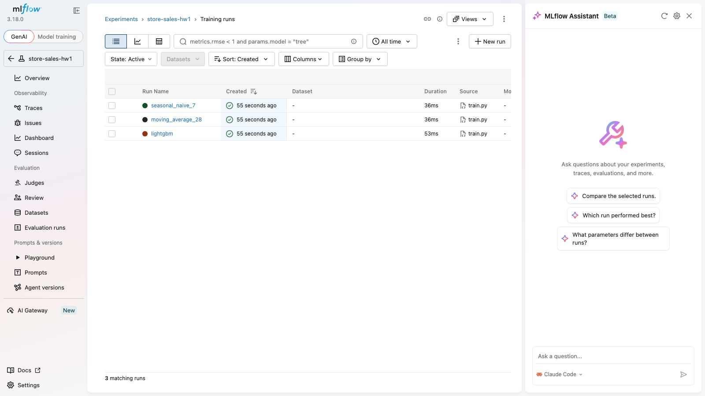
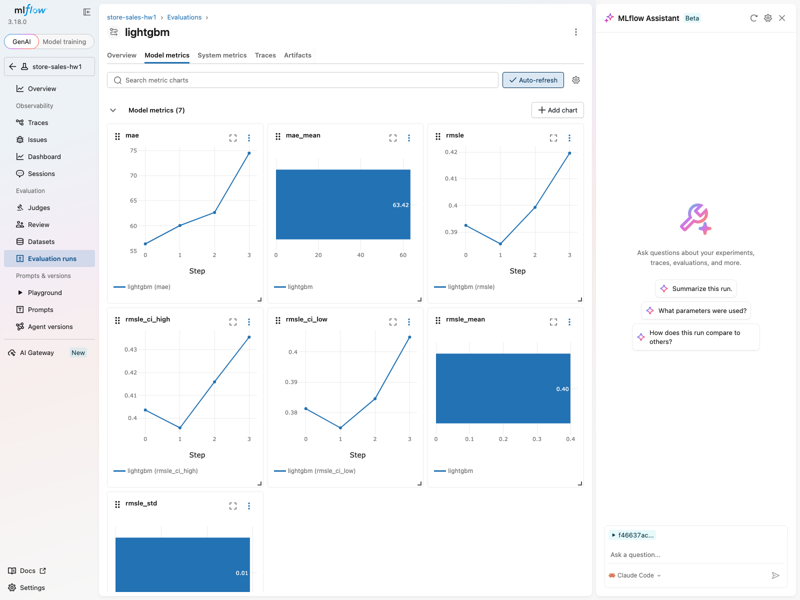

# Store Sales: прогноз продаж на 16 дней

ДЗ №1 и ДЗ №2 по курсу «R&D в ML», ИТМО. Ширяев Илья, M4150.

Этот README - отчет по ДЗ №1 (постановка, baseline, протокол валидации). Отчет по ДЗ №2 (улучшения, трекинг, абляции) - в [HW2.md](HW2.md).

Соревнование: [Store Sales - Time Series Forecasting](https://www.kaggle.com/competitions/store-sales-time-series-forecasting)

## Как запустить

Нужен Python 3.11 или 3.12. Зависимости зафиксированы в `pyproject.toml` и `uv.lock` (менеджер пакетов [uv](https://docs.astral.sh/uv/)).

```bash
uv sync                # создаст .venv и поставит зависимости из uv.lock
```

Без uv: `python3 -m venv .venv && source .venv/bin/activate && pip install -r requirements.txt` (`requirements.txt` выгружен из `uv.lock`).

Данные: на Kaggle во вкладке Data нажать Download All и распаковать csv в `data/raw/`.

```bash
uv run bash scripts/run_baseline.sh                 # конфиг по умолчанию configs/baseline.yaml
uv run bash scripts/run_baseline.sh configs/my.yaml # другой конфиг
```

Скрипт по очереди запускает:
- `src/eda.py` - короткий EDA, результат в `outputs/eda.json` и `outputs/plots/`;
- `src/train.py` - обучение и валидация на 4 фолдах, результат в `outputs/results_*.csv`, запись запусков в MLflow;
- `src/evaluate.py` - анализ ошибок на последнем фолде, результат в `outputs/errors_*.csv` и графики.

Эксперименты ДЗ №2 (все конфиги из `configs/hw2/`, затем сводная таблица и графики):

```bash
uv run bash scripts/run_hw2.sh
```

Все параметры лежат в `configs/baseline.yaml`, копия использованного конфига сохраняется в `outputs/config_used.json`. Полный прогон занимает около 30 секунд. LightGBM запускается с `deterministic: true` и фиксированным `seed`, поэтому повторный прогон дает те же цифры.

**Качество кода:** линтер и форматтер ruff (настройки в `pyproject.toml`), хук pre-commit:

```bash
uv run ruff check src && uv run ruff format --check src
uv run pre-commit install   # ruff будет проверять код перед каждым коммитом
```

### Трекинг экспериментов (MLflow)

`train.py` пишет в MLflow (локальная база `mlflow.db`, эксперимент `store-sales-hw1`) по одному run на модель:
- параметры: конфиг, гиперпараметры LightGBM, лаги и окна, `seed`, md5 файла `train.csv` как версия данных, тег с git commit;
- метрики: `rmsle`, `mae` и границы бутстрап-интервала по фолдам (step = номер фолда), средние по фолдам;
- артефакты: конфиг, `results_by_fold.csv`, для LightGBM еще важность признаков и сравнение с baseline.

Посмотреть: `uv run mlflow ui --backend-store-uri sqlite:///mlflow.db`, затем http://127.0.0.1:5000.




## 1. Постановка задачи

Нужно предсказать продажи сети магазинов Favorita (Эквадор) на 16 дней вперед: для каждого магазина, каждой категории товаров и каждого дня.

- **Объект:** пара «магазин + категория» в конкретный день. Всего 54 магазина × 33 категории = 1782 ряда.
- **Что известно на момент прогноза:** продажи до дня прогноза, данные о магазинах, календарь праздников и промо на дни прогноза. Промо есть в `test.csv`, то есть магазин знает про них заранее.
- **Зачем это нужно:** по такому прогнозу планируют закупки. Если недопрогнозировать, товара не хватит. Если перепрогнозировать, часть продуктов испортится.
- **Ограничения:** горизонт сразу 16 дней, много рядов с нулями, есть сезонные всплески.

**Гипотеза:** если вместо наивного прогноза обучить LightGBM на лагах продаж, календаре и промо, то RMSLE на локальной валидации снизится. Наивный прогноз просто повторяет прошлые продажи этого ряда, а модель учится сразу на всех рядах и учитывает день недели и промо.

**Критерий проверки:** гипотеза подтверждается, если на каждом из 4 фолдов 95% бутстрап-интервал разницы RMSLE(лучший наивный) - RMSLE(LightGBM) лежит целиком выше нуля.

## 2. Формализация

- **X:** магазин, категория, тип и кластер магазина, промо, национальный выходной и событие в этот день, день недели, число, месяц, лаги продаж и скользящие средние.
- **y:** `sales` в этот день. Модель учится на `log1p(sales)`, потому что метрика RMSLE: обычная MSE на логарифме - это квадрат RMSLE.
- **Тип задачи:** прогноз временного ряда (forecasting), решаю как регрессию.
- **Единица наблюдения:** один день одного ряда.
- **Одно предсказание:** одна строка `test.csv` (дата, магазин, категория).
- **Признаки на inference:** все лаги не меньше 16 дней (в коде стоит проверка `assert`). Поэтому даже на 16-й день прогноза все признаки известны и не нужно знать продажи внутри периода прогноза.

## 3. Данные (EDA)

Цифры из `outputs/eda.json`, графики `plots/eda_total_sales.png`, `plots/eda_by_weekday.png`.

- train: 3 000 888 строк, с 2013-01-01 по 2017-08-15. test: 28 512 строк, с 2017-08-16 по 2017-08-31.
- Пропусков в train нет, но нет дней 25 декабря: магазины закрыты. Я добавил эти дни, чтобы лаги считались по календарю, но в обучение как таргет они не идут.
- 31% строк с нулевыми продажами. 96 рядов ничего не продавали последние 56 дней.
- 15% значений продаж дробные (весовые товары), поэтому `sales` - это не только штуки.
- Продажи очень неравномерные: медиана 11, 99-й перцентиль 5507, максимум 124 717. Поэтому работаю с логарифмом продаж.
- 8 магазинов открылись позже начала данных, например магазин 52 только в апреле 2017. Нули до открытия - это не отсутствие спроса, их тоже убираю из обучения (но оставляю для лагов).
- Сильная недельная сезонность: в субботу и воскресенье средние продажи 433 и 463, в будни 284-347.
- 20% строк с промо. С промо средние продажи 1138, без промо 158. Но в промо чаще попадают крупные категории, так что это не чистый эффект промо.
- Больше всего продаж в GROCERY I, BEVERAGES, PRODUCE, CLEANING, DAIRY.
- **Праздники:** беру только национальные. Признак `holiday` - выходной день (Holiday, Transfer, Additional, Bridge, без перенесенных). `event` отдельно (Black Friday, Cyber Monday, чемпионат мира и т.п.). Тип Work Day - это рабочая суббота, не выходной, его не беру.
- **Шум:** по описанию соревнования, на продажи влияют землетрясение 16.04.2016 и выплаты зарплат 15-го числа и в конце месяца.
- **Возможные лики:**
  - `transactions.csv` (число чеков) есть только для прошлого, на дни прогноза его не будет. Не использую.
  - В `oil.csv` есть цены нефти и на дни теста, но в реальности будущую цену не знаешь. Тоже не использую.
  - Случайное разбиение строк на train/val дало бы модели соседние дни того же ряда. Для временного ряда так делать нельзя.

## 4. Baseline

Сравниваю три модели:

| Модель | Как считает прогноз |
|---|---|
| `seasonal_naive_7` | продажи в тот же день недели на последней неделе перед прогнозом |
| `moving_average_28` | средние продажи ряда за последние 28 дней |
| `lightgbm` | LightGBM на признаках из раздела 2 |

Основной baseline для дальнейших сравнений - `lightgbm`, наивные модели нужны как нижняя планка.

- **Почему это честный baseline:** признаки простые, гиперпараметры стандартные и не подбирались, нет годовой сезонности, нефти, транзакций и ансамблей.
- **Preprocessing:** добавил 25 декабря, target `log1p(sales)`, прогноз переводится обратно через `expm1` и обрезается снизу нулем. Никаких нормировок, обученных на данных, нет, поэтому через preprocessing лик не попадает.
- **Признаки:** лаги 16, 21, 28, 35 дней и скользящие средние за 7, 14, 28 дней, посчитанные со сдвигом 16. И лаги, и скользящие средние считаются по `log1p(sales)`, то есть `roll_mean_7` - это среднее логарифмов за 7 дней, а не логарифм средних продаж.
- **Обучение:** данные с 2016-06-01 до начала фолда, примерно год. Начало выбрано так, чтобы в обучение попало одно лето и не попал месяц после землетрясения 16.04.2016. Другие варианты не сравнивал, это исследовательский вопрос 2.
- **Гиперпараметры** (`configs/baseline.yaml`): `learning_rate 0.05`, `num_leaves 31`, `min_data_in_leaf 100`, `feature_fraction 0.8`, 300 деревьев, `seed 42`.

## 5. Протокол оценки

- **Основная метрика: RMSLE** = sqrt(mean((log(1 + pred) - log(1 + fact))²)). Это официальная метрика соревнования. Ошибка считается на логарифмах, поэтому промах в 100 против 200 весит примерно как 1000 против 2000, а маленькие категории не теряются на фоне больших. Каждая строка (день ряда) входит с одинаковым весом. Это не процентная ошибка - из-за `+1` около нуля она ведет себя иначе.
- **Дополнительная метрика: MAE.** Показывает ошибку в единицах `sales` (штуки или килограммы) и больше зависит от крупных категорий.
- **Разбиение по времени**, 4 фолда по 16 дней в конце train:

| фолд | период валидации |
|---|---|
| 0 | 2017-06-13 .. 2017-06-28 |
| 1 | 2017-06-29 .. 2017-07-14 |
| 2 | 2017-07-15 .. 2017-07-30 |
| 3 | 2017-07-31 .. 2017-08-15 |

На каждом фолде модель обучается только на днях до его начала. Длина фолда 16 дней, как в тесте. Последний фолд ближе всего к тестовому периоду.

- **Почему так корректно:** будущие данные не попадают в обучение, а все модели проверяются на одинаковых фолдах.
- **Итоговая оценка:** среднее и стандартное отклонение RMSLE по 4 фолдам.
- **Доверительные интервалы:** на каждом фолде считаю бутстрап по рядам. 1000 раз выбираю 1782 ряда с повторами и пересчитываю RMSLE. Так получаю 95% интервал. Для сравнения моделей использую парный бутстрап - на одной и той же выборке рядов считаю разницу RMSLE двух моделей. Беру ряды, а не строки, потому что дни внутри ряда зависят друг от друга.
- **Как читать интервал:** он показывает, насколько RMSLE зависит от того, какие ряды попали в выборку, при тех же 16 днях фолда. При этом интервал не учитывает связь между рядами одного магазина или одной категории. Он также не учитывает, что на все ряды влияют одни и те же дни - праздники и выплаты зарплат. Поэтому это не интервал для ошибки на следующих 16 днях. Неопределенность по времени видна только из разброса между 4 фолдами.
- **Выбор модели:** только по локальной валидации. Public leaderboard Kaggle для выбора не использую.

## 6. Результаты

`outputs/results_summary.csv`:

| модель | RMSLE (mean ± std по 4 фолдам) | MAE |
|---|---|---|
| **lightgbm** | **0.3992 ± 0.0147** | 63.4 |
| moving_average_28 | 0.4824 ± 0.0276 | 109.6 |
| seasonal_naive_7 | 0.5448 ± 0.0482 | 80.0 |

RMSLE по фолдам и 95% интервал для LightGBM (`outputs/results_by_fold.csv`):

| модель | 0 | 1 | 2 | 3 |
|---|---|---|---|---|
| lightgbm | 0.393 [0.381, 0.404] | 0.386 [0.375, 0.396] | 0.399 [0.385, 0.416] | 0.420 [0.405, 0.436] |
| moving_average_28 | 0.480 | 0.459 | 0.469 | 0.522 |
| seasonal_naive_7 | 0.524 | 0.518 | 0.521 | 0.617 |

Насколько LightGBM лучше, разница RMSLE и 95% интервал (`outputs/lgbm_vs_baselines.csv`):

| против | 0 | 1 | 2 | 3 |
|---|---|---|---|---|
| moving_average_28 | 0.088 [0.081, 0.095] | 0.073 [0.068, 0.078] | 0.070 [0.061, 0.078] | 0.102 [0.066, 0.137] |
| seasonal_naive_7 | 0.131 [0.122, 0.140] | 0.132 [0.124, 0.141] | 0.122 [0.111, 0.133] | 0.197 [0.163, 0.234] |

- По критерию из раздела 1 гипотеза подтвердилась - на всех 4 фолдах интервал разницы с лучшим наивным прогнозом (`moving_average_28`) выше нуля. RMSLE в среднем снизился с 0.482 до 0.399.
- На последнем фолде (31.07-15.08) всем моделям хуже, и интервалы там шире.
- Ошибка LightGBM по дням последнего фолда от 0.39 до 0.44 (`plots/rmsle_by_day.png`). Это один фолд, поэтому вывод о зависимости ошибки от дня горизонта отсюда не делаю.
- Самые важные признаки по gain, среднее по фолдам - скользящие средние за 7, 14 и 28 дней, затем `lag_21` (`outputs/feature_importance.csv`). Промо на 8-м месте. Это важность внутри модели, а не проверка вклада признака - абляции не делал.

**Типичные ошибки** на последнем фолде (`outputs/errors_by_series.csv`, `outputs/errors_by_day.csv`, `plots/worst_series.png`):

1. **Школьный сезон.** Худшие ряды - канцтовары (SCHOOL AND OFFICE SUPPLIES) в магазинах 47, 50, 44, 48. В магазине 47 в эти дни продавали 228-1332 в день, а модель дала 45-105. Последние недели продаж почти не было, и модель не знает про начало учебного года.
2. **Маленькие шумные продажи.** Для GROCERY II в магазине 19 факт скачет от 0 до 50, а модель дает 17-49. На маленьких числах RMSLE сильно штрафует такие промахи.
3. **Выходные после переноса праздника.** По всей сети 12-13 августа (сб-вс) модель перепрогнозировала сумму продаж на 19% и 21%. 11 августа был перенесенный национальный праздник (тип Transfer), поэтому получились длинные выходные. Часть людей, видимо, уехала. Модель видит праздник только в сам день и не знает про длинные выходные. А 31.07-01.08 (начало месяца, после зарплаты) модель недопрогнозировала на 12-13%.

129 рядов ничего не продали за последний фолд. На них ошибка маленькая, так что это не главная проблема.

## 7. Выводы

- **Что получилось:** я собрал воспроизводимый baseline и проверил его на 4 временных фолдах. LightGBM снизил RMSLE с 0.482 у лучшего наивного прогноза до 0.399. То есть лаги, календарь и промо помогли улучшить прогноз на этой валидации.
- **Где baseline слабый:** хуже всего модель сработала на канцтоварах перед началом учебного года. Она смотрит на последние недели и не видит похожий всплеск продаж год назад. Еще были заметные ошибки в длинные выходные и на маленьких шумных рядах.
- **Следующая гипотеза:** дальше я бы добавил лаг 364 дня и признак начала учебного года. Сравнить нужно на тех же фолдах и отдельно посмотреть канцтовары. Так можно проверить, действительно ли помогает годовая сезонность.
- **Ограничения:** все фолды относятся к лету 2017 года. Поэтому пока нельзя сказать, что модель так же сработает зимой, перед Рождеством или в другие праздники. 4 фолда - это немного для оценки разброса. Локальные праздники и нефть пока не используются.

## Мои исследовательские вопросы

1. **Помогает ли лаг 364 дня на сезонных категориях?** Добавить лаг 364 и сравнить RMSLE на SCHOOL AND OFFICE SUPPLIES и в целом на тех же 4 фолдах. Улучшение засчитываю, если оно есть на каждом фолде.
2. **Сколько истории брать для обучения?** Сравнить обучение с 2017-01-01, с 2016-06-01 и с 2015-01-01 по среднему и std RMSLE на 4 фолдах.
3. **Нужны ли свежие лаги для первых дней прогноза?** Сейчас все лаги от 16 дней. Проверить отдельную модель для дней 1-7 с лагами от 7 дней и сравнить ошибку по дням прогноза.
4. **Держится ли baseline в другие сезоны?** Сейчас все фолды летние. Сделать такие же 4 фолда по 16 дней перед Рождеством 2016 и весной 2017 и сравнить RMSLE LightGBM и наивных прогнозов. Особенно интересно, как модель справится с декабрем, где у нее нет годового лага.

## Использование ИИ-агента

ДЗ сделано в режиме «с агентом». Агенты: Claude Opus 5.5 (Anthropic) в Claude Code.

- **Агенты делали:** код (`src/`, `scripts/`, конфиг).
- **Я делал:** выбор задачи, постановку и подход к валидации, репозиторий, проверку результатов и README.

## Источники

Чужие ноутбуки и готовые решения с Kaggle не использовались. Метрика RMSLE и описание данных - со страницы соревнования на Kaggle. Сам подход (LightGBM на log1p с лагами не меньше горизонта) - типовой для этого соревнования.
